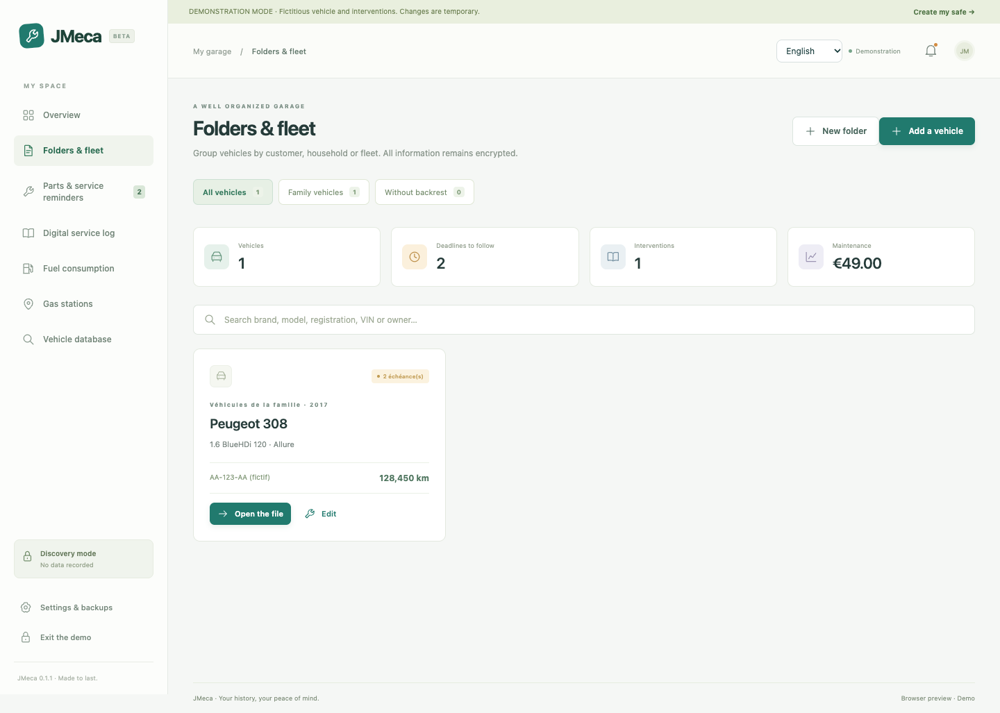
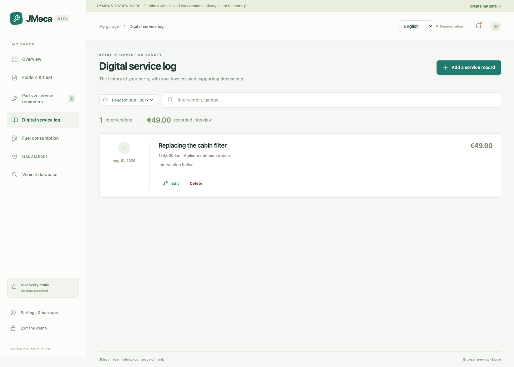

<p align="center"></p>

<h1 align="center">JMeca</h1>

<p align="center"><b>Eine verschlüsselte Garage für alle Fahrzeuge: Wartung, Erinnerungen, Serviceheft, Kraftstoff und Kosten.</b></p>

<p align="center"> <a href="https://github.com/jeremdevgit/jmeca/releases"></a> <a href="LICENSE"></a> <a href="https://github.com/jeremdevgit/jmeca/actions/workflows/build.yml"></a></p>

<p align="center"><a href="README.md">English</a> · <a href="README.fr.md">Français</a> · <a href="README.es.md">Español</a> · <b>Deutsch</b> · <a href="README.it.md">Italiano</a> · <a href="README.pt.md">Português</a> · <a href="README.zh.md">简体中文</a> · <a href="README.ja.md">日本語</a></p>

<p align="center"><a href="https://github.com/jeremdevgit/jmeca/releases"><b>⬇ Herunterladen</b></a></p>


JMeca ist eine Desktop-Garage mit Wartungsheft, gebaut mit Tauri 2, Rust und TypeScript auf der Web-Engine des Systems. Gedacht für einen Haushalt oder eine kleine Werkstatt.

## Auf einen Blick

| | |
|---|---|
| **Kategorie** | 📒 Produktivität & Daten |
| **Plattformen** | Windows · macOS · Linux |
| **Oberfläche** | 8 Sprachen (EN, FR, ES, DE, IT, PT, ZH, JA) |
| **Preis** | Kostenlos, quelloffen, ohne Werbung und Telemetrie |
| **Status** | Beta |
| **Lizenz** | [GPL-3.0-or-later](LICENSE) |

## Funktionen

- **Mehrere Fahrzeuge**, Kunden- oder Familienordner, Flottensuche und schneller Wechsel.
- **Wartung**: Teile, eigene Intervalle nach Datum oder Kilometerstand, anstehende und überfällige Erinnerungen, Flotten-Wartungsliste, CSV-Bericht pro Kundenordner.
- **Digitales Serviceheft** mit Rechnungen und Fotos, Fahrzeugschein und technischen Notizen.
- **Kraftstoff und Kosten**: Verbrauch, Ausgaben und Preise französischer Tankstellen aus offiziellen offenen Daten.
- **Offline-Katalog** mit 53.596 Versionen von 1980–2026 (EPA, ADEME und Herstellerarchive), neun generische 3D-Silhouetten, ein anpassbares Audi-A3-8P-Modell und GLB-Import.

<p> </p>
<p> </p>

*Demo-Screenshots mit fiktiven Fahrzeugen und Beispielpreisen. [Alle Screenshots](captures/).*

## Deine Daten

- Tresor und Anhänge sind mit **AES-256-GCM** verschlüsselt; der Schlüssel wird aus deinem Passwort abgeleitet (PBKDF2-SHA-256, 600.000 Iterationen). Das Passwort wird nie gespeichert.
- Automatische Sperre bei Inaktivität, **verschlüsselte Sicherungen** und Wiederherstellung.
- Exportierte CSV-Dateien und Anhänge verlassen den Tresor unverschlüsselt, nach Bestätigung. Alte Sicherungen können gelöschte Daten oder ein altes Passwort enthalten.
- Intervalle, Teilenummern, Reifengrößen und Lampen müssen mit dem Handbuch des Fahrzeugs abgeglichen werden: Die Kataloge sind keine zertifizierten Datenbanken.

## Installation

| | Windows 10/11 | macOS 12+ | Linux |
|---|---|---|---|
| Datei | `JMeca-Setup-Windows-x64.exe` | `.pkg` (empfohlen) oder `.dmg`, universal | `.deb` (Debian/Ubuntu x64) |
| Engine | WebView2 | WebKit | WebKitGTK 4.1 |

Herunterladen von der [Release-Seite](https://github.com/jeremdevgit/jmeca/releases) und mit `SHA256SUMS.txt` vergleichen. Die Installer sind weder kommerziell signiert noch notarisiert: unter Windows in SmartScreen bestätigen, unter macOS *Systemeinstellungen › Datenschutz & Sicherheit › Trotzdem öffnen*. Das Ersetzen der App löscht niemals deinen Tresor.

## Selbst bauen

```sh
npm ci
npm run desktop:dev        # mit den Tauri-Voraussetzungen; die Demo nutzt fiktive Daten
npm run build && npm test && npx playwright test
cargo test --locked --manifest-path src-tauri/Cargo.toml
npm run desktop:build      # Installer für die aktuelle Plattform
```

`npm run dev` startet eine Browser-Vorschau mit eigenem verschlüsseltem IndexedDB-Tresor. Unter macOS erzeugt `zsh scripts/package_macos.sh` `.dmg`, `.pkg` und Prüfsummen.

**Grenzen**: Erinnerungen erscheinen nur bei geöffnetem JMeca; keine Mehrbenutzerkonten; der ganze Tresor wird bei jedem Speichern neu geschrieben. Unter Linux enthält der WebKitGTK-Stack einen bekannten `glib`-Hinweis, den JMeca nicht erreicht und der upstream noch nicht behoben ist ([SECURITY.md](SECURITY.md)).

## Lizenz

GPL-3.0-or-later – siehe [LICENSE](LICENSE). Datenquellen und Drittlizenzen: [THIRD_PARTY.md](THIRD_PARTY.md).

---

Eine Sicherheitslücke gefunden? Bitte privat melden (siehe [SECURITY.md](SECURITY.md)), nicht in einem öffentlichen Issue.

## Weitere freie Software von jeremdevgit

Alle kostenlos, quelloffen und werbefrei.

**🛠️ System & Hardware** — [Boîte à outils](https://github.com/jeremdevgit/boite-a-outils) · [rJb](https://github.com/jeremdevgit/rjb) · [LJ Hub](https://github.com/jeremdevgit/lj-hub) · [Decklight](https://github.com/jeremdevgit/decklight)

**📒 Produktivität & Daten** — [Carnet de notes](https://github.com/jeremdevgit/carnet-rust) · [Suite Libre](https://jeremdevgit.github.io/suite-libre/)

**🎮 Musik & Spiele** — [Pomme](https://github.com/jeremdevgit/pomme) · [Ludothèque](https://github.com/jeremdevgit/ludotheque) · [AutoDex](https://github.com/jeremdevgit/autodex) · [Batailles de France](https://github.com/jeremdevgit/batailles-de-france)
