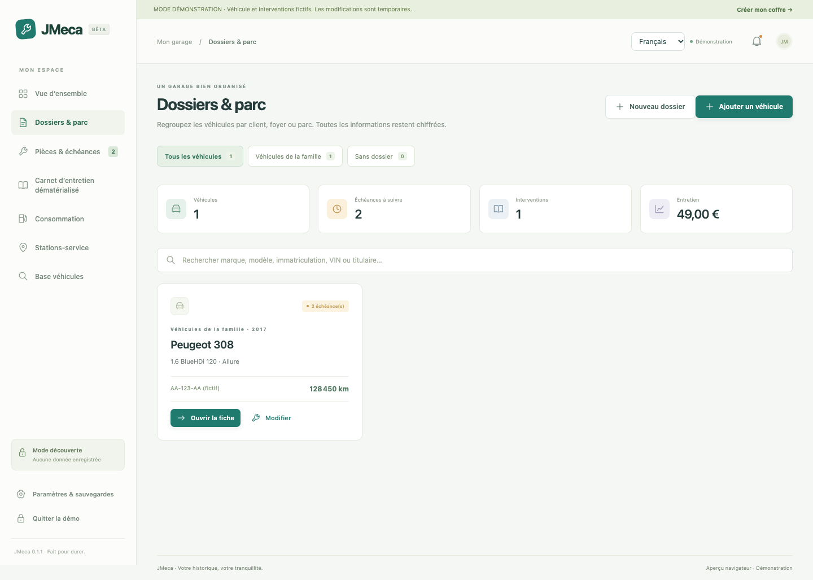
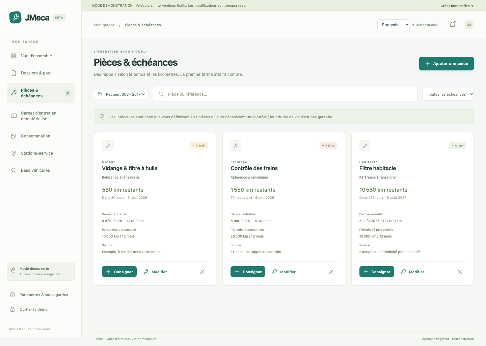
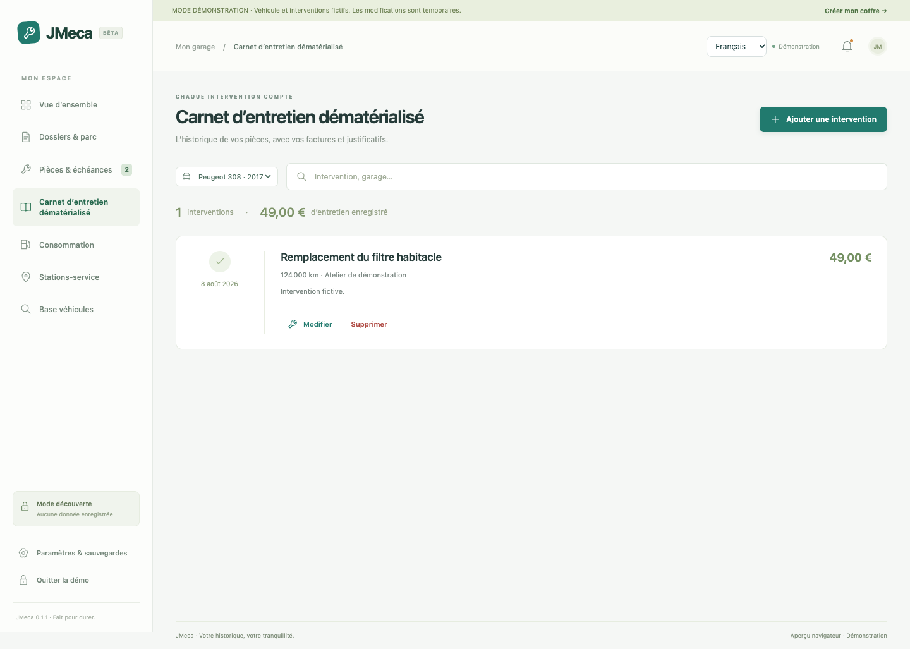
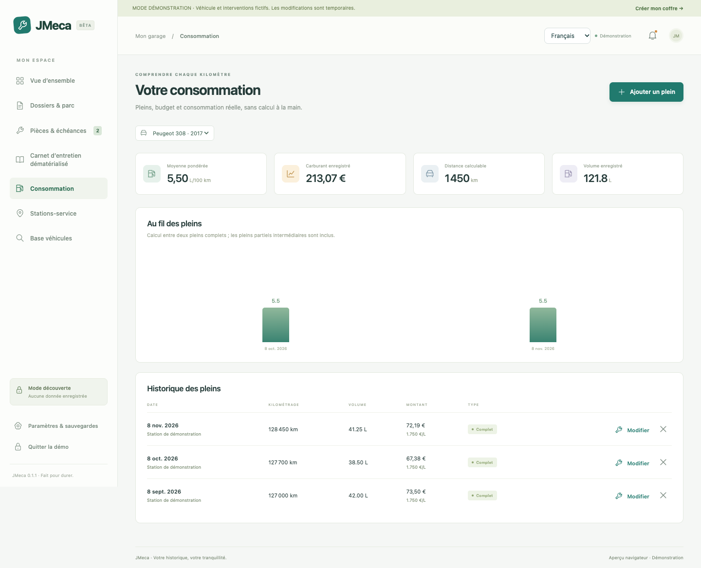

<p align="center"></p>

<h1 align="center">JMeca</h1>

<p align="center"><b>Un garage chiffré pour tous vos véhicules : entretien, rappels, carnet d'entretien, carburant et dépenses.</b></p>

<p align="center"> <a href="https://github.com/jeremdevgit/jmeca/releases"></a> <a href="LICENSE"></a> <a href="https://github.com/jeremdevgit/jmeca/actions/workflows/build.yml"></a></p>

<p align="center"><a href="README.md">English</a> · <b>Français</b> · <a href="README.es.md">Español</a> · <a href="README.de.md">Deutsch</a> · <a href="README.it.md">Italiano</a> · <a href="README.pt.md">Português</a> · <a href="README.zh.md">简体中文</a> · <a href="README.ja.md">日本語</a></p>

<p align="center"><a href="https://github.com/jeremdevgit/jmeca/releases"><b>⬇ Télécharger</b></a></p>


JMeca est un garage et carnet d'entretien de bureau, construit avec Tauri 2, Rust et TypeScript, qui utilise le moteur web du système. Il convient à un foyer ou à un petit atelier.

## En bref

| | |
|---|---|
| **Catégorie** | 📒 Productivité et données |
| **Plateformes** | Windows · macOS · Linux |
| **Interface** | 8 langues (EN, FR, ES, DE, IT, PT, ZH, JA) |
| **Prix** | Gratuit, open source, sans publicité ni télémétrie |
| **État** | Bêta |
| **Licence** | [GPL-3.0-or-later](LICENSE) |

## Fonctions

- **Plusieurs véhicules**, dossiers clients ou familiaux, recherche dans le parc et changement rapide.
- **Entretien** : pièces, échéances personnalisées par date ou kilométrage, rappels à venir et en retard, file d'entretien du parc, rapport CSV par dossier client.
- **Carnet d'entretien numérique** avec factures et photos, carte grise et notes techniques.
- **Carburant et dépenses** : consommation, budget, et prix des stations françaises issus des données ouvertes officielles.
- **Catalogue hors ligne** de 53 596 versions de 1980 à 2026 (EPA, ADEME et archives constructeurs), neuf silhouettes 3D génériques, un modèle Audi A3 8P personnalisable et l'import GLB.

<p> </p>
<p> </p>

*Captures de démonstration avec des véhicules fictifs et des prix illustratifs. [Toutes les captures](captures/fr/).*

## Vos données

- Le coffre et les pièces jointes sont chiffrés en **AES-256-GCM** ; la clé est dérivée de votre mot de passe (PBKDF2-SHA-256, 600 000 itérations). Le mot de passe n'est jamais stocké.
- Verrouillage automatique après inactivité, **sauvegardes chiffrées** et restauration.
- Les CSV et pièces jointes exportés sortent du coffre en clair, après confirmation. Une ancienne sauvegarde peut encore contenir des données supprimées ou un ancien mot de passe.
- Échéances, références de pièces, dimensions de pneus et ampoules sont à vérifier dans le manuel du véhicule : les catalogues ne sont pas des bases certifiées.

## Installer

| | Windows 10/11 | macOS 12+ | Linux |
|---|---|---|---|
| Fichier | `JMeca-Setup-Windows-x64.exe` | `.pkg` (recommandé) ou `.dmg`, universel | `.deb` (Debian/Ubuntu x64) |
| Moteur | WebView2 | WebKit | WebKitGTK 4.1 |

Récupérez-les sur la [page des versions](https://github.com/jeremdevgit/jmeca/releases) et comparez avec `SHA256SUMS.txt`. Les installateurs ne sont ni signés par un certificat commercial ni notarisés : confirmez dans SmartScreen sous Windows, ou passez par *Réglages Système › Confidentialité et sécurité › Ouvrir quand même* sous macOS. Remplacer l'application n'efface jamais votre coffre.

## Compiler

```sh
npm ci
npm run desktop:dev        # avec les prérequis Tauri ; choisissez la démo pour des données fictives
npm run build && npm test && npx playwright test
cargo test --locked --manifest-path src-tauri/Cargo.toml
npm run desktop:build      # installateur pour la plateforme courante
```

`npm run dev` lance un aperçu dans le navigateur avec son propre coffre IndexedDB chiffré. Sous macOS, `zsh scripts/package_macos.sh` produit le `.dmg`, le `.pkg` et les sommes de contrôle.

**Limites** : les rappels n'apparaissent que si JMeca est ouvert ; pas de comptes multi-utilisateurs ; tout le coffre est réécrit à chaque enregistrement. Sous Linux, la pile WebKitGTK porte un avis connu sur `glib` que JMeca n'atteint pas et qui n'est pas encore corrigé en amont ([SECURITY.md](SECURITY.md)).

## Licence

GPL-3.0-or-later — voir [LICENSE](LICENSE). Sources de données et licences tierces : [THIRD_PARTY.md](THIRD_PARTY.md).

---

Une faille de sécurité ? Signalez-la en privé (voir [SECURITY.md](SECURITY.md)) plutôt que dans un ticket public.

## Mes autres logiciels libres

Tous gratuits, open source et sans publicité.

**🛠️ Système et matériel** — [Boîte à outils](https://github.com/jeremdevgit/boite-a-outils) · [rJb](https://github.com/jeremdevgit/rjb) · [LJ Hub](https://github.com/jeremdevgit/lj-hub) · [Decklight](https://github.com/jeremdevgit/decklight)

**📒 Productivité et données** — [Carnet de notes](https://github.com/jeremdevgit/carnet-rust) · [Suite Libre](https://jeremdevgit.github.io/suite-libre/)

**🎮 Musique et jeux** — [Pomme](https://github.com/jeremdevgit/pomme) · [Ludothèque](https://github.com/jeremdevgit/ludotheque) · [AutoDex](https://github.com/jeremdevgit/autodex) · [Batailles de France](https://github.com/jeremdevgit/batailles-de-france)
