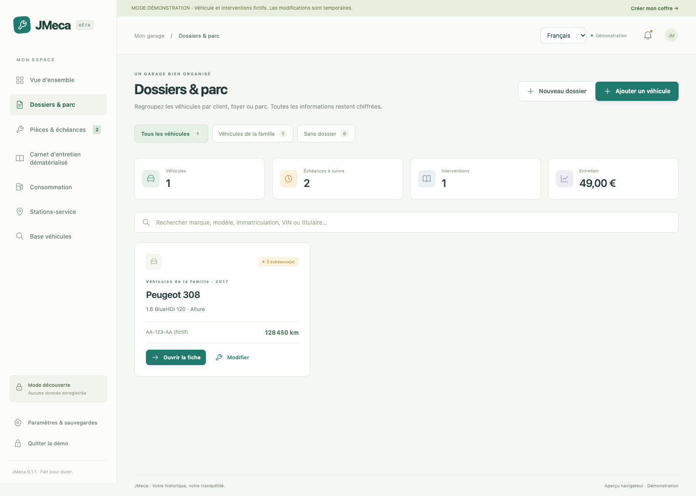
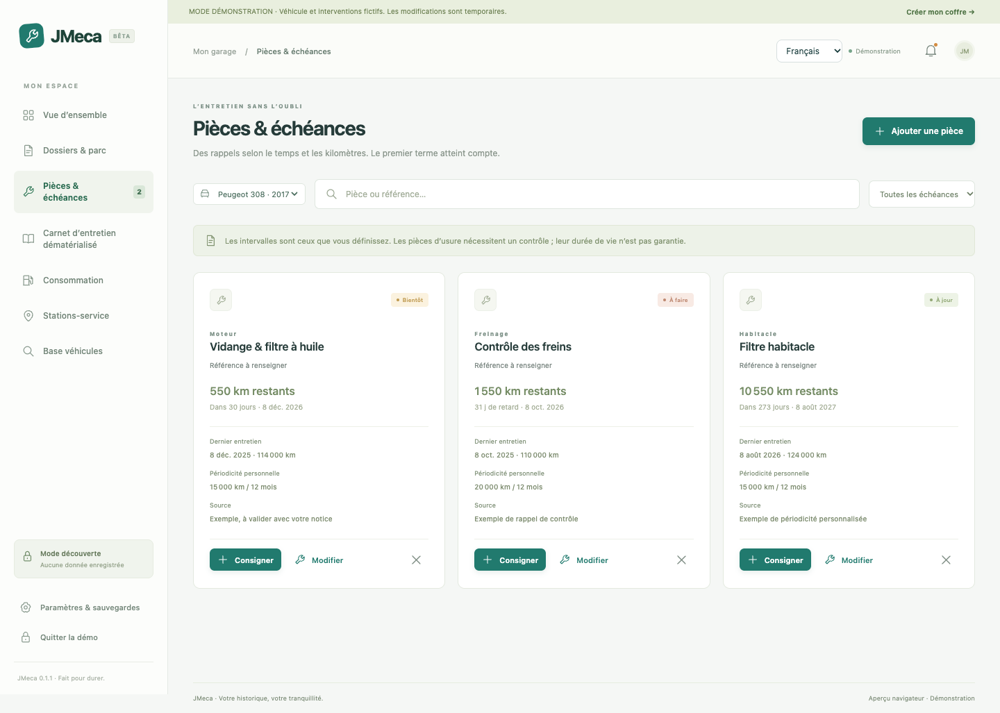
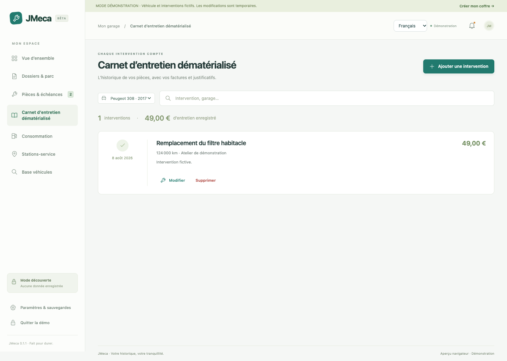
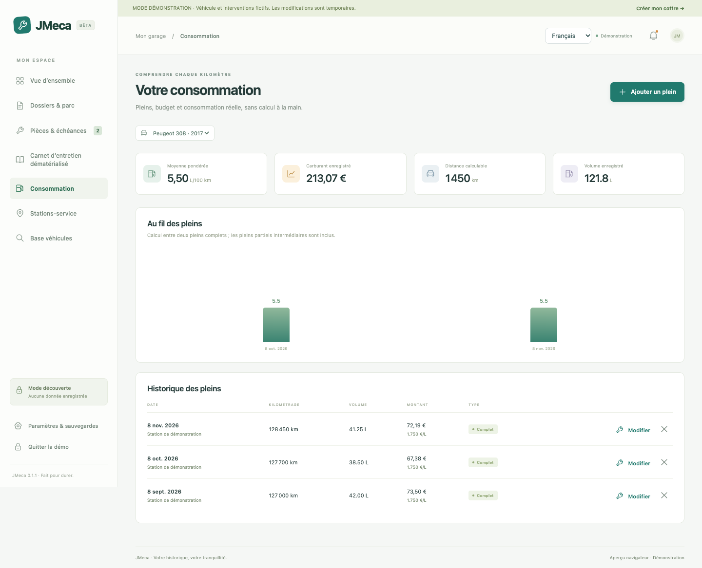
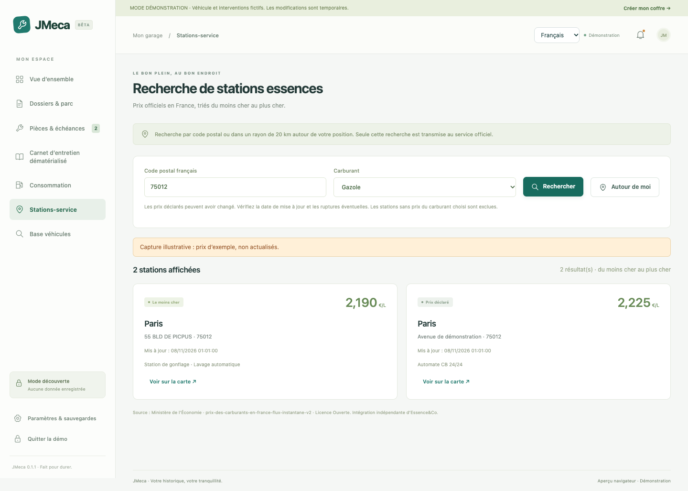
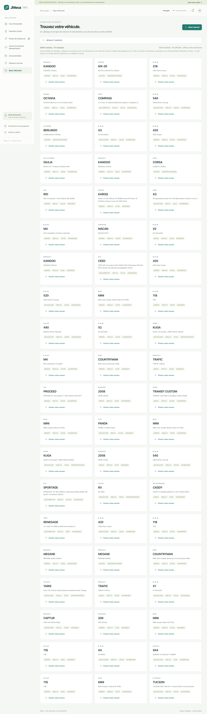

<p align="center"></p>

# JMeca 0.1.1 — garage personnel chiffré

[](https://github.com/jeremdevgit/jmeca/actions/workflows/build.yml) [](https://github.com/jeremdevgit/jmeca/actions/workflows/codeql.yml)


**Français** · [English](README.md) · [Español](docs/README.es.md) · [Deutsch](docs/README.de.md) · [Italiano](docs/README.it.md) · [Português](docs/README.pt.md) · [简体中文](docs/README.zh-CN.md) · [日本語](docs/README.ja.md)

**Tous ses véhicules dans un garage chiffré.** JMeca est une application de bureau de **jeremdevgit**, construite en Rust avec Tauri 2 et une interface TypeScript. Elle utilise le moteur web natif du système et n’embarque pas Chromium. Cette version est publiée pour permettre sa validation fonctionnelle.

| | Windows 10/11 | macOS 12+ | Linux |
|---|---|---|---|
| Installation | `JMeca-Setup-Windows-x64.exe` | `JMeca-0.1.1-macOS-Universal.pkg` ou `.dmg` | `JMeca-0.1.1-Linux-amd64.deb` |
| Architecture | x64 | Apple Silicon et Intel | x64 Debian/Ubuntu |
| Moteur web | WebView2 | WebKit | WebKitGTK 4.1 |

👉 **[Télécharger la préversion Windows, macOS ou Linux](https://github.com/jeremdevgit/jmeca/releases/tag/v0.1.1-beta.2)**.

## Essayer

Sur le Mac de développement, ouvrir l’application `JMeca.app` livrée séparément et choisir **Explorer la démonstration**. Aucune donnée personnelle n’est nécessaire ; les changements de démonstration ne sont pas sauvegardés.

Pour un garage personnel, créer un mot de passe d’au moins 12 caractères. Il ne peut pas être récupéré. Exporter une sauvegarde chiffrée sur un autre support après les premiers essais.

L’application Mac a été lancée localement sur Apple Silicon. Les versions Windows et Linux sont validées par compilation et tests automatisés, sans essai interactif sur leurs systèmes cibles. L’installateur Mac universel est construit en CI ; une diffusion sans avertissement système demanderait une identité de signature et une notarisation Apple.

## Aperçu en images

Ces captures utilisent des véhicules fictifs et, pour les stations, des prix d’exemple.


<p> </p>
<p> </p>
<p> </p>

[Les 18 captures de toutes les fonctions](captures/fr/)

## Installer sur Windows

Télécharger `JMeca-Setup-Windows-x64.exe` depuis la [version publiée](https://github.com/jeremdevgit/jmeca/releases/tag/v0.1.1-beta.2), puis lancer l’installateur. Il crée les raccourcis et l’entrée de désinstallation. WebView2 est requis. L’exécutable n’a pas de certificat commercial ; SmartScreen peut demander une confirmation. Comparer son SHA-256 à `SHA256SUMS.txt` avec `Get-FileHash`.

## Installer sur macOS

- **`.pkg` (conseillé) :** ouvrir le paquet et suivre l’assistant. JMeca est placé dans `/Applications` ; remplacer l’app ne supprime pas le coffre chiffré du profil utilisateur.
- **`.dmg` :** ouvrir l’image disque et glisser `JMeca.app` dans `Applications`.

L’app macOS est universelle Apple Silicon et Intel. Elle porte une signature d’intégrité ad hoc ; le paquet n’a pas de signature Apple Developer ID et aucun des deux formats n’est notarisé. macOS peut demander *Réglages Système › Confidentialité et sécurité › Ouvrir quand même*. Vérifier le SHA-256 avec `shasum -a 256`.

## Installer sur Linux

Télécharger `JMeca-0.1.1-Linux-amd64.deb` sur un bureau Debian ou Ubuntu x64 compatible et l’installer avec le gestionnaire de paquets. WebKitGTK 4.1 et les dépendances du paquet sont requis. Vérifier le SHA-256 avec `sha256sum`.

## Contrôles qualité

| Contrôle | Résultat |
|---|---|
| Compilation TypeScript | Réussie en local |
| Tests fonctionnels de base | 11 réussis |
| Parcours navigateur, régression de sécurité et 8 langues | 16 réussis |
| Tests Rust | 2 réussis |
| Format Rust et avertissements Clippy | Réussis en local ; imposés en CI |
| CodeQL | Actions, TypeScript, Python et Rust sur GitHub |
| Audit des dépendances JavaScript | Aucune vulnérabilité connue signalée à la vérification |
| Audit des dépendances Rust | Aucun avis bloquant ; voir la note `glib` ci-dessous |

Le [workflow GitHub](.github/workflows/build.yml) relance les audits de dépendances, les tests et les compilations Windows/macOS/Linux. Son badge reflète le résultat distant. Deux problèmes du code ont été détectés et corrigés avant publication, avec tests de régression. L’analyse Rust mentionne aussi des avis informatifs sur des dépendances indirectes.

La chaîne Linux WebKitGTK/GTK3 contient un avis connu sur un itérateur de `glib`. JMeca n’appelle pas directement cette API ; la chaîne amont ne propose pas encore de version corrigée compatible. Ce risque résiduel est documenté, sans le présenter comme une faille corrigée.

## Fonctions présentes

- Plusieurs véhicules et dossiers par client, foyer ou parc, avec coordonnées et notes chiffrées, recherche dans le parc par immatriculation, VIN, titulaire, marque et modèle, résumé des échéances et coûts par dossier. Supprimer un dossier conserve les voitures et leur historique dans « Sans dossier ».
- Sélection du véhicule actif, saisie manuelle ou recherche dans **3 604 versions ADEME** embarquées. Recherche par marque, modèle, version commerciale, énergie ou cylindrée ; informations de puissance et boîte quand disponibles.
- Kilométrage manuel croissant, également mis à jour par les interventions et les pleins.
- Pièces, références et rappels personnels, date et/ou kilométrage ; le premier terme atteint déclenche l’échéance. Préavis réglable. Gestion des fins de mois et années bissextiles.
- Modèles de noms d’opérations, sans périodicités constructeur inventées. Source de chaque préconisation à renseigner.
- Onglet **Carnet d’entretien dématérialisé** : interventions par pièce, date, kilométrage, coût, garage, notes et justificatifs PDF / PNG / JPEG / WebP. Une photo de carte grise peut y être jointe.
- Factures exportables après confirmation explicite de déchiffrement. Les fichiers sont enregistrés, sans être exécutés dans l’interface.
- Carte grise : immatriculation, titulaire, VIN, première immatriculation et document PDF ou image directement joint à la fiche véhicule ; notes et champs utiles pour pneus, ampoules, huile et transmission.
- Suivi de carburant et calcul pondéré entre pleins complets, avec intégration des pleins partiels intermédiaires. Le premier plein complet est un point de départ, son volume est exclu du calcul de consommation.
- Historique des coûts d’entretien et du carburant.
- Stations françaises via le service officiel du ministère : recherche par code postal ou rayon de 20 km, carburant, prix, mise à jour, rupture signalée, services et lien cartographique. Maximum de 30 stations, triées par prix. La disponibilité dépend du service public et du réseau.
- Neuf silhouettes Kenney CC0 téléchargées et autonomes, rotation / zoom 3D, import d’un GLB 2.0 autonome de 10 Mo maximum, conservé chiffré. Pas de téléchargement silencieux de modèles à l’ouverture.
- Coffre chiffré, sauvegarde / restauration avec justificatifs inclus, changement de mot de passe, verrouillage manuel et automatique après dix minutes d’inactivité.
- Enregistrement atomique sur ordinateur, copie locale `.bak` du dernier état précédent, validation des sauvegardes avant restauration. En aperçu navigateur : IndexedDB chiffré et protection contre l’écriture concurrente entre onglets.

## Limites à connaître pour valider cette version

- Les périodicités, références de pièces compatibles, dimensions de pneus et types d’ampoules ne proviennent pas d’une base constructeur certifiée. Il faut les confirmer dans la notice correspondant au moteur, à la finition, à l’année et éventuellement au VIN. Le catalogue ADEME ne les fournit pas.
- Les modèles 3D embarqués sont des **silhouettes génériques**, pas des répliques de marques. Le modèle précis d’un véhicule nécessite un fichier dont l’utilisateur détient les droits. Le catalogue ADEME représente une sélection de véhicules commercialisés, pas tous les modèles historiques.
- Pas d’API publique documentée Essence&Co identifiée : utilisation de l’open data officiel français, sans connexion à un compte Essence&Co. Pas de reproduction intégrale de ses fonctionnalités (itinéraires, contribution communautaire, offres commerciales, etc.).
- Les rappels sont affichés dans JMeca ouvert. Aucun service en arrière-plan, notification système ou rappel lorsque l’application est fermée.
- Chaque pièce jointe est limitée à 10 Mo ; environ 40 Mo cumulés dans le coffre. Le coffre est un instantané chiffré complet, réécrit à l’enregistrement : adapté à un garage personnel, pas à une flotte importante.
- Cette première version pour garagistes convient à un poste local et un utilisateur à la fois : pas de comptes employés, droits par rôle, facturation, rendez-vous ou synchronisation entre postes.
- Pas de synchronisation cloud, de lecture OCR de carte grise, de diagnostic OBD, de décodage VIN en ligne ni d’import d’historique depuis un autre logiciel.
- Le chiffrement protège les données **au repos** ; il ne protège pas un coffre déjà ouvert contre un logiciel malveillant présent sur l’appareil. Les fichiers volontairement exportés déchiffrés sortent du coffre. Le moteur JavaScript ne permet pas de garantir l’effacement physique immédiat de toutes ses copies mémoire.
- Aucun logiciel ne peut être garanti exempt de bugs. Les tests sont livrés ; aucun audit indépendant ou certification n’est revendiqué.

## Développement local

Prérequis : Node.js 22 LTS ou ultérieur, Rust stable et prérequis Tauri du système : https://tauri.app/start/prerequisites/.

```sh
npm ci
npm run desktop:dev
```

Aperçu navigateur séparé du stockage de bureau :

```sh
npm run dev
```

Ouvrir `http://127.0.0.1:1420`. Les données sont chiffrées dans IndexedDB de ce navigateur. Effacer ses données de site efface ce coffre. Il n’y a aucun serveur de stockage distant.

Compilation et contrôles :

```sh
npm run build
npm test
npx playwright install chromium
npx playwright test
cargo test --locked --manifest-path src-tauri/Cargo.toml
npm run desktop:build
```

Résultats des installateurs dans `src-tauri/target/release/bundle/`. Tauri compile sur le système hôte. Linux requiert notamment WebKitGTK 4.1 ; Windows WebView2 et les outils C++ ; macOS les outils Xcode.

Les versions sont verrouillées par les deux lockfiles. Le script `scripts/fetch-data.py` permet de rafraîchir les ressources publiques ; il requiert Python 3.10+ et Internet. Les données sont déjà embarquées, donc le script n’est pas nécessaire à la compilation. Revoir les licences et les changements du catalogue avant toute actualisation.

## Stockage et sécurité

Tous les champs et noms de fichiers sont dans le contenu chiffré. Le conteneur expose seulement le format, l’algorithme, le nombre d’itérations, un sel de 16 octets, un nonce de 12 octets et la longueur du contenu chiffré. AES-256-GCM authentifie le contenu avec des données associées fixes et un nonce aléatoire neuf à chaque sauvegarde. La clé Web Crypto n’est pas exportable et le mot de passe n’est jamais enregistré.

Sur ordinateur, `garage.jmeca` et `garage.jmeca.bak` sont dans le dossier de données Tauri de `fr.jmeca.garage` (sur macOS : `~/Library/Application Support/fr.jmeca.garage/`). Le dossier est créé en 0700 sur Unix et les fichiers temporaires en 0600. Sous Windows, les droits du dossier utilisateur s’appliquent. Une seule instance de l’application est autorisée.

Aucun accès générique au système de fichiers ni au shell n’est donné à l’interface. Les échanges natifs sont limités au coffre, aux exports choisis par dialogue système et à la requête officielle de stations, dont les paramètres sont validés et la taille / durée de réponse bornées. Les GLB importés ne peuvent pas charger de ressource distante. Une politique CSP limite les ressources de l’application.

La sauvegarde automatique `.bak` peut garder l’ancien mot de passe après un changement. Les anciennes sauvegardes ne sont pas modifiées ni effacées par une suppression dans le garage. Le mot de passe d’une sauvegarde restaurée devient celui du coffre. Exporter régulièrement un fichier `.jmeca` sur un autre support ; la copie `.bak` sur le même disque ne remplace pas cette sauvegarde.

## GitHub et versions de bureau

Le code source est publié sous GPL-3.0-or-later, avec **jeremdevgit** comme éditeur dans les métadonnées. Le workflow `.github/workflows/build.yml` se lance à chaque mise à jour de `main`, sur les PR et manuellement ; il compile les versions Windows, macOS et Linux. Les artefacts doivent être essayés sur chaque plateforme avant une diffusion comme versions recommandées. La signature Apple ad hoc n’est pas une notarisation. Voir `THIRD_PARTY.md` pour les sources et licences des ressources tierces.

## Mes logiciels

Tous libres et gratuits — [github.com/jeremdevgit](https://github.com/jeremdevgit) :

| Logiciel | Plateforme | En bref |
|---|---|---|
| [Boîte à outils](https://github.com/jeremdevgit/boite-a-outils) | Windows, macOS | Entretien de l’ordinateur et recherche de fichiers |
| [Carnet de notes](https://github.com/jeremdevgit/carnet-rust) | Windows | Notes chiffrées et synchronisation expérimentale |
| [Pomme](https://github.com/jeremdevgit/pomme) | Windows | Apple Music et musique locale |
| [rJb](https://github.com/jeremdevgit/rjb) | Windows | Éclairage RGB |
| [Ludothèque](https://github.com/jeremdevgit/ludotheque) | macOS | Bibliothèque et lanceur de jeux |
| [Suite Libre](https://github.com/jeremdevgit/suite-libre) | Navigateur | Six outils sans compte |
| [Batailles de France](https://github.com/jeremdevgit/batailles-de-france) | Navigateur | Jeu de stratégie en temps réel |
