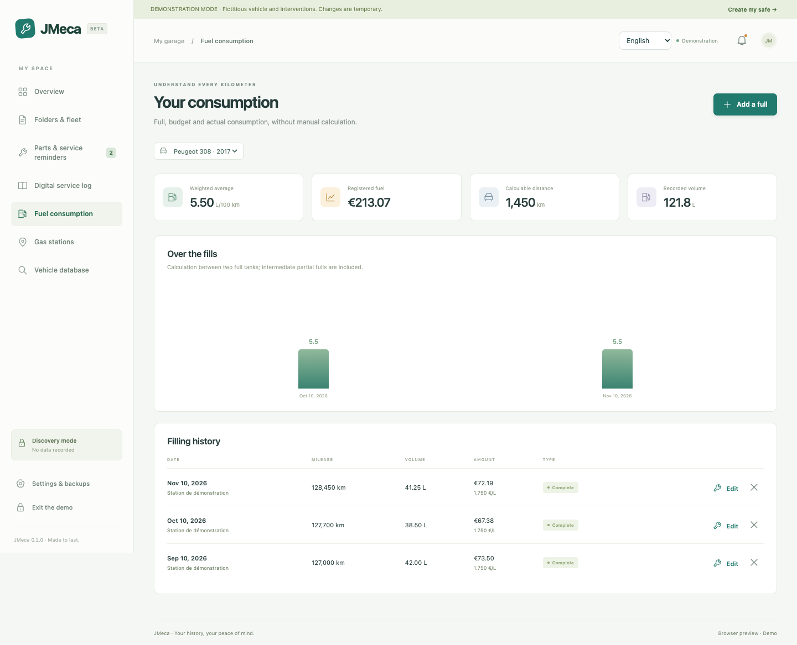

<p align="center"></p>

<h1 align="center">JMeca</h1>

<p align="center"><b>Un garage cifrato per tutti i tuoi veicoli: manutenzione, promemoria, libretto tagliandi, carburante e spese.</b></p>

<p align="center"> <a href="https://github.com/jeremdevgit/jmeca/releases"></a> <a href="LICENSE"></a> <a href="https://github.com/jeremdevgit/jmeca/actions/workflows/build.yml"></a></p>

<p align="center"><a href="README.md">English</a> · <a href="README.fr.md">Français</a> · <a href="README.es.md">Español</a> · <a href="README.de.md">Deutsch</a> · <b>Italiano</b> · <a href="README.pt.md">Português</a> · <a href="README.zh.md">简体中文</a> · <a href="README.ja.md">日本語</a></p>

<p align="center"><a href="https://github.com/jeremdevgit/jmeca/releases"><b>⬇ Scarica</b></a></p>


JMeca è un garage e libretto di manutenzione per il desktop, realizzato con Tauri 2, Rust e TypeScript e basato sul motore web del sistema. Adatto a una famiglia o a una piccola officina.

## In breve

| | |
|---|---|
| **Categoria** | 📒 Produttività e dati |
| **Piattaforme** | Windows · macOS · Linux |
| **Interfaccia** | 8 lingue (EN, FR, ES, DE, IT, PT, ZH, JA) |
| **Prezzo** | Gratuito, open source, senza pubblicità né telemetria |
| **Stato** | Beta |
| **Licenza** | [GPL-3.0-or-later](LICENSE) |

## Funzioni

- **Più veicoli**, cartelle di clienti o di famiglia, ricerca nel parco e cambio rapido.
- **Manutenzione**: ricambi, scadenze personalizzate per data o chilometraggio, promemoria in arrivo e scaduti, coda di manutenzione del parco, report CSV per cliente.
- **Libretto digitale** con fatture e foto, carta di circolazione e note tecniche.
- **Carburante e spese**: consumi, budget e prezzi dei distributori francesi dai dati aperti ufficiali.
- **Catalogo offline** di 53.596 versioni dal 1980 al 2026 (EPA, ADEME e archivi dei costruttori), nove sagome 3D generiche, un modello Audi A3 8P personalizzabile e importazione GLB.

<p> </p>
<p> </p>

*Screenshot dimostrativi con veicoli fittizi e prezzi illustrativi. [Tutti gli screenshot](captures/).*

## I tuoi dati

- La cassaforte e gli allegati sono cifrati con **AES-256-GCM**; la chiave deriva dalla tua password (PBKDF2-SHA-256, 600.000 iterazioni). La password non viene mai salvata.
- Blocco automatico per inattività, **backup cifrati** e ripristino.
- CSV e allegati esportati escono dalla cassaforte in chiaro, dopo conferma. I vecchi backup possono contenere dati eliminati o una vecchia password.
- Scadenze, codici ricambio, misure degli pneumatici e lampadine vanno verificati sul manuale del veicolo: i cataloghi non sono banche dati certificate.

## Installazione

| | Windows 10/11 | macOS 12+ | Linux |
|---|---|---|---|
| File | `JMeca-Setup-Windows-x64.exe` | `.pkg` (consigliato) o `.dmg`, universale | `.deb` (Debian/Ubuntu x64) |
| Motore | WebView2 | WebKit | WebKitGTK 4.1 |

Scaricali dalla [pagina delle versioni](https://github.com/jeremdevgit/jmeca/releases) e confrontali con `SHA256SUMS.txt`. Gli installer non sono firmati con un certificato commerciale né notarizzati: conferma in SmartScreen su Windows, oppure usa *Impostazioni di Sistema › Privacy e sicurezza › Apri comunque* su macOS. Sostituire l'app non cancella mai la tua cassaforte.

## Compilare

```sh
npm ci
npm run desktop:dev        # con i prerequisiti Tauri; scegli la demo per dati fittizi
npm run build && npm test && npx playwright test
cargo test --locked --manifest-path src-tauri/Cargo.toml
npm run desktop:build      # installer per la piattaforma corrente
```

`npm run dev` avvia un'anteprima nel browser con la propria cassaforte IndexedDB cifrata. Su macOS, `zsh scripts/package_macos.sh` genera `.dmg`, `.pkg` e checksum.

**Limiti**: i promemoria compaiono solo con JMeca aperto; niente account multiutente; l'intera cassaforte viene riscritta a ogni salvataggio. Su Linux lo stack WebKitGTK include un avviso noto su `glib` che JMeca non raggiunge e che non è ancora corretto a monte ([SECURITY.md](SECURITY.md)).

## Licenza

GPL-3.0-or-later — vedi [LICENSE](LICENSE). Fonti dei dati e licenze di terze parti: [THIRD_PARTY.md](THIRD_PARTY.md).

---

Hai trovato una vulnerabilità? Segnalala in privato (vedi [SECURITY.md](SECURITY.md)) e non in una issue pubblica.

## Altro software libero di jeremdevgit

Tutti gratuiti, open source e senza pubblicità.

**🛠️ Sistema e hardware** — [Boîte à outils](https://github.com/jeremdevgit/boite-a-outils) · [rJb](https://github.com/jeremdevgit/rjb) · [LJ Hub](https://github.com/jeremdevgit/lj-hub) · [Decklight](https://github.com/jeremdevgit/decklight)

**📒 Produttività e dati** — [Carnet de notes](https://github.com/jeremdevgit/carnet-rust) · [Suite Libre](https://jeremdevgit.github.io/suite-libre/)

**🎮 Musica e giochi** — [Pomme](https://github.com/jeremdevgit/pomme) · [Ludothèque](https://github.com/jeremdevgit/ludotheque) · [AutoDex](https://github.com/jeremdevgit/autodex) · [Batailles de France](https://github.com/jeremdevgit/batailles-de-france)
