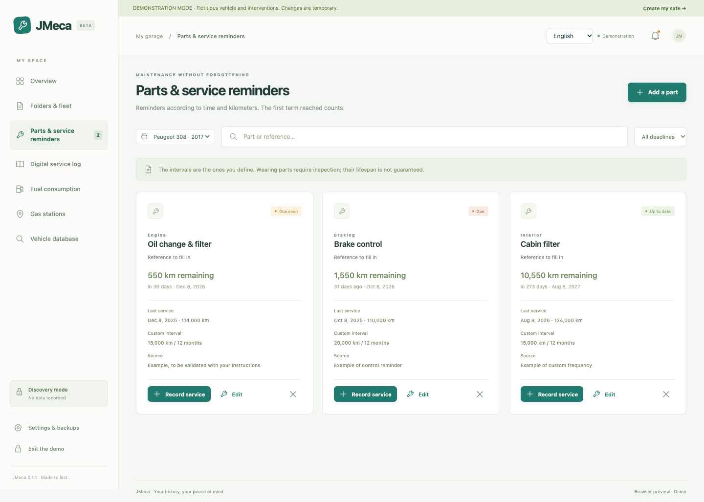

<p align="center"></p>

<h1 align="center">JMeca</h1>

<p align="center"><b>すべての車両のための暗号化ガレージ：整備、リマインダー、整備記録、燃料、費用。</b></p>

<p align="center"> <a href="https://github.com/jeremdevgit/jmeca/releases"></a> <a href="LICENSE"></a> <a href="https://github.com/jeremdevgit/jmeca/actions/workflows/build.yml"></a></p>

<p align="center"><a href="README.md">English</a> · <a href="README.fr.md">Français</a> · <a href="README.es.md">Español</a> · <a href="README.de.md">Deutsch</a> · <a href="README.it.md">Italiano</a> · <a href="README.pt.md">Português</a> · <a href="README.zh.md">简体中文</a> · <b>日本語</b></p>

<p align="center"><a href="https://github.com/jeremdevgit/jmeca/releases"><b>⬇ ダウンロード</b></a></p>


JMeca は Tauri 2、Rust、TypeScript で作られた、OS の Web エンジンで動くデスクトップ用のガレージ兼整備記録アプリです。家庭や小さな整備工場に向いています。

## 概要

| | |
|---|---|
| **カテゴリー** | 📒 生産性とデータ |
| **対応環境** | Windows · macOS · Linux |
| **表示言語** | 8 言語（英・仏・西・独・伊・葡・中・日） |
| **価格** | 無料・オープンソース・広告なし・テレメトリーなし |
| **ステータス** | ベータ版 |
| **ライセンス** | [GPL-3.0-or-later](LICENSE) |

## 機能

- **複数の車両**、顧客や家族ごとのフォルダー、車両の検索とすばやい切り替え。
- **整備**：部品、日付または走行距離によるカスタム周期、期限が近い／過ぎたリマインダー、全車両の整備キュー、顧客フォルダーごとの CSV レポート。
- **デジタル整備記録簿**：請求書と写真、車検証、技術メモ。
- **燃料と費用**：燃費、支出、フランス公式オープンデータによるガソリンスタンド価格。
- **オフラインカタログ**：1980〜2026 年の 53,596 バージョン（EPA、ADEME、メーカー資料）、9 種類の汎用 3D シルエット、カスタマイズ可能な Audi A3 8P モデル、GLB の読み込み。

<p> </p>
<p> </p>

*架空の車両と例示価格によるデモ画面です。[すべてのスクリーンショット](captures/)。*

## データの扱い

- 保管庫と添付ファイルは **AES-256-GCM** で暗号化されます。鍵はパスワードから導出され（PBKDF2-SHA-256、60 万回）、パスワード自体は保存されません。
- 一定時間操作がないと自動ロック、**暗号化バックアップ**と復元。
- 書き出した CSV と添付ファイルは、確認のうえ暗号化されずに保管庫の外へ出ます。古いバックアップには削除済みデータや古いパスワードが残っている場合があります。
- 整備周期、部品番号、タイヤサイズ、電球は車両の取扱説明書で確認してください。カタログは認定データベースではありません。

## インストール

| | Windows 10/11 | macOS 12 以降 | Linux |
|---|---|---|---|
| ファイル | `JMeca-Setup-Windows-x64.exe` | `.pkg`（推奨）または `.dmg`、ユニバーサル | `.deb`（Debian/Ubuntu x64） |
| エンジン | WebView2 | WebKit | WebKitGTK 4.1 |

[リリースページ](https://github.com/jeremdevgit/jmeca/releases)からダウンロードし、`SHA256SUMS.txt` と照合してください。インストーラーは商用証明書で署名されておらず公証もされていないため、Windows では SmartScreen で確認し、macOS では *システム設定 › プライバシーとセキュリティ › このまま開く* を使います。アプリを置き換えても保管庫が消えることはありません。

## ソースからビルド

```sh
npm ci
npm run desktop:dev        # Tauri の前提条件が必要。架空データで試すならデモを選択
npm run build && npm test && npx playwright test
cargo test --locked --manifest-path src-tauri/Cargo.toml
npm run desktop:build      # 現在のプラットフォーム用インストーラー
```

`npm run dev` は、独自の暗号化 IndexedDB 保管庫を持つブラウザープレビューを起動します。macOS では `zsh scripts/package_macos.sh` で `.dmg`、`.pkg`、チェックサムを作成できます。

**制限**：リマインダーは JMeca を開いている間だけ表示されます。マルチユーザーアカウントはなく、保存のたびに保管庫全体を書き直します。Linux の WebKitGTK スタックには既知の `glib` 勧告がありますが、JMeca は該当 API を使っておらず、上流でもまだ修正されていません（[SECURITY.md](SECURITY.md)）。

## ライセンス

GPL-3.0-or-later — [LICENSE](LICENSE) を参照。データの出典とサードパーティのライセンス：[THIRD_PARTY.md](THIRD_PARTY.md)。

---

脆弱性を見つけたら、公開 Issue ではなく非公開で報告してください（[SECURITY.md](SECURITY.md) を参照）。

## jeremdevgit のその他のフリーソフトウェア

すべて無料・オープンソース・広告なし。

**🛠️ システムとハードウェア** — [Boîte à outils](https://github.com/jeremdevgit/boite-a-outils) · [rJb](https://github.com/jeremdevgit/rjb) · [LJ Hub](https://github.com/jeremdevgit/lj-hub) · [Decklight](https://github.com/jeremdevgit/decklight)

**📒 生産性とデータ** — [Carnet de notes](https://github.com/jeremdevgit/carnet-rust) · [Suite Libre](https://jeremdevgit.github.io/suite-libre/)

**🎮 音楽とゲーム** — [Pomme](https://github.com/jeremdevgit/pomme) · [Ludothèque](https://github.com/jeremdevgit/ludotheque) · [AutoDex](https://github.com/jeremdevgit/autodex) · [Batailles de France](https://github.com/jeremdevgit/batailles-de-france)
