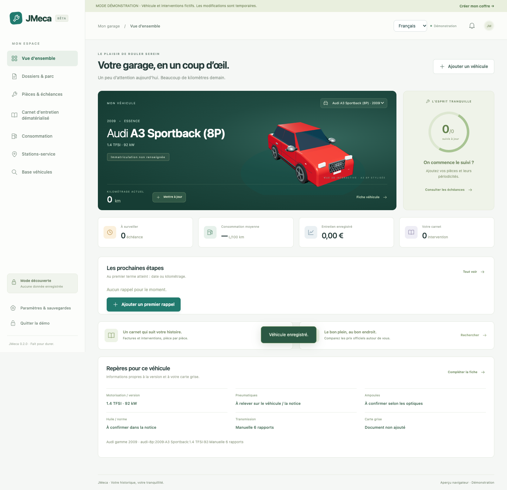
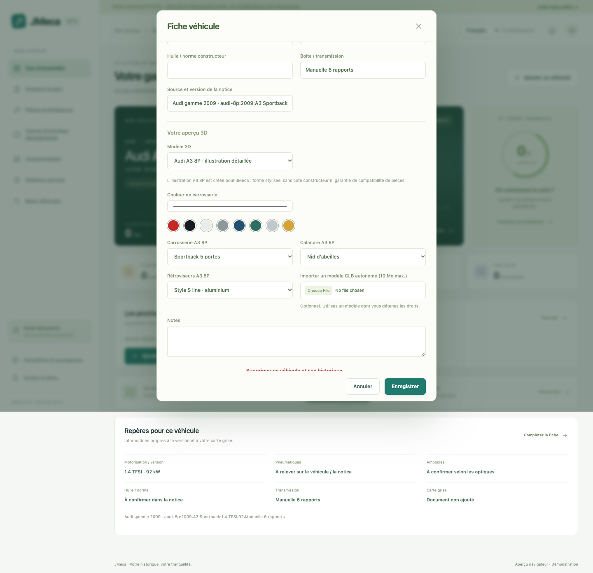

<p align="center"></p>

# JMeca

[](https://github.com/jeremdevgit/jmeca/actions/workflows/build.yml) [](https://github.com/jeremdevgit/jmeca/actions/workflows/codeql.yml)


**English** · [Français](README.fr.md) · [Español](docs/README.es.md) · [Deutsch](docs/README.de.md) · [Italiano](docs/README.it.md) · [Português](docs/README.pt.md) · [简体中文](docs/README.zh-CN.md) · [日本語](docs/README.ja.md)

**Look after every vehicle in one encrypted garage.** JMeca is a lightweight desktop garage and maintenance tracker by **jeremdevgit**. It uses Tauri 2, Rust and TypeScript, with the operating system's web engine. The interface is available in **French, English, Spanish, German, Italian, Portuguese, Simplified Chinese and Japanese**. It follows the system language on first launch and has a language selector.

| | Windows 10/11 | macOS 12+ | Linux |
|---|---|---|---|
| Installer | `JMeca-Setup-Windows-x64.exe` | `JMeca-0.2.0-macOS-Universal.pkg` or `.dmg` | `JMeca-0.2.0-Linux-amd64.deb` |
| Architecture | x64 | Apple Silicon and Intel | x64 Debian/Ubuntu |
| Web engine | WebView2 | WebKit | WebKitGTK 4.1 |

👉 **[Download the Windows, macOS and Linux preview](https://github.com/jeremdevgit/jmeca/releases/tag/v0.2.0-beta.1)**.

## Features

- Multiple vehicles, client or household folders, fleet search and active vehicle switching.
- Fleet-wide maintenance queue and confirmed CSV report export for a customer folder.
- Parts, custom service intervals by date or mileage, upcoming and overdue reminders.
- Digital service log with invoices and photos, vehicle registration document and technical notes.
- Fuel consumption and expense tracking, and French fuel station prices from official open data.
- Offline catalog of 53,596 versions from 1980–2026 (EPA, ADEME and manufacturer archives), year filter, detailed Audi A3 8P engine/body variants, a customizable stylized A3 8P model in several colors, plus nine generic 3D silhouettes and optional GLB import.
- Password protected local vault, encrypted backups, restore and automatic lock after inactivity.

## Screenshots

Demo screenshots use fictional vehicles and illustrative fuel prices. They show the real interface captured during browser tests.


<p> </p>
<p> </p>
<p> </p>
<p> </p>

[All screenshots, including registration, attachments, 3D, settings and backups](captures/fr/)

## Quality checks

| Check | Result |
|---|---|
| TypeScript production build | Passed locally |
| Core unit tests | 13 passed |
| Browser flows, security regression and 8 languages | 17 passed |
| Rust unit tests | 2 passed |
| Rust formatting and Clippy warnings | Passed locally; enforced in CI |
| CodeQL | Actions, TypeScript, Python and Rust on GitHub |
| JavaScript dependency audit | No known vulnerability reported at review time |
| Rust dependency audit | No blocking advisory; see the Linux `glib` note below |

The [CI workflow](.github/workflows/build.yml) repeats dependency audits, tests and desktop builds on GitHub. Its live badge above reflects the remote run. Static analysis identified two application issues before publication; both were fixed and covered by regression tests. The Rust advisory scan also reports informational maintenance notices for transitive crates; see the build log.

## Windows installation

Download `JMeca-Setup-Windows-x64.exe` from the [release](https://github.com/jeremdevgit/jmeca/releases/tag/v0.2.0-beta.1) and run the installer. It creates application shortcuts and an uninstall entry. WebView2 is required. The executable is not signed with a commercial certificate, so Windows SmartScreen may ask for confirmation. Compare its SHA-256 with `SHA256SUMS.txt` using `Get-FileHash`.

## macOS installation

- **`.pkg` (recommended):** open the installer and follow the steps. The application is installed in `/Applications`; replacing it does not erase the encrypted vault in your user profile.
- **`.dmg`:** open the disk image and drag `JMeca.app` into `Applications`.

The macOS installers contain a universal Apple Silicon and Intel app. The app has an ad hoc integrity signature, but the package has no Apple Developer ID signature and neither format is notarized. macOS may require *System Settings › Privacy & Security › Open Anyway*. Compare the SHA-256 with `SHA256SUMS.txt` using `shasum -a 256`.

## Linux installation

Download `JMeca-0.2.0-Linux-amd64.deb` on a compatible Debian or Ubuntu x64 desktop and install it with your package manager. WebKitGTK 4.1 and the package dependencies are required. Compare its SHA-256 with `SHA256SUMS.txt` using `sha256sum`.

The Windows and Linux installers pass automated builds and tests but have not been launched interactively on their target systems. The macOS app has been launched locally. This remains a preview for functional review.

## Try it from source

Run `npm ci` followed by `npm run desktop:dev` with the [Tauri prerequisites](https://tauri.app/start/prerequisites/) installed. Choose the demo for fictional data. To store real data, create a password of at least 12 characters and export an encrypted backup to another drive. A browser preview is available with `npm run dev`; its encrypted IndexedDB vault is separate from the desktop app.

Run `npm run build`, `npm test`, `npx playwright test` and `cargo test --locked --manifest-path src-tauri/Cargo.toml` for checks. `npm run desktop:build` builds an app or installer for the current platform. On macOS, run `zsh scripts/package_macos.sh` after building the app to create a disk image, an installer package and their checksums. The GitHub workflow builds a universal Mac app with the Intel Rust target installed.

## Security and limits

JMeca encrypts vault contents and attachments at rest with AES-256-GCM. The key is derived from your password with PBKDF2-SHA-256 (600,000 iterations). The password is not stored. Encryption cannot protect an unlocked vault on a compromised computer. An exported attachment leaves the encrypted vault. Previous backups can still contain deleted data or an old password.

Fleet-wide maintenance queue and CSV report export by customer folder. Exported CSV files are unencrypted and require confirmation.

Service intervals, compatible part references, tire dimensions and bulb types must be checked against the manual for the exact vehicle. The EPA, ADEME and manufacturer catalogs are not certified maintenance or parts-fitment databases. The station search uses French official open data, not an Essence&Co API. Reminders appear while JMeca is open; there are no background notifications or multi-user accounts. A full vault snapshot is rewritten on each save, so this version is suited to a personal garage or a small local workshop, not a large fleet.

See [the French documentation](README.fr.md) for detailed behavior and [third-party sources](THIRD_PARTY.md) for data and licenses. Original code is licensed under GPL-3.0-or-later; third-party materials retain their own licenses.

The Linux WebKitGTK/GTK3 dependency chain includes a known `glib` iterator advisory. JMeca does not call that iterator API directly, and the upstream stack does not yet offer a compatible patched `glib`. This residual risk is documented rather than represented as a fixed vulnerability.

## Repository layout

```text
src/                     TypeScript interface, vault and localization
src-tauri/               Rust desktop host and native commands
tests/                   Core, browser and security regression tests
captures/                Screenshots with demonstration data
scripts/package_macos.sh macOS disk image and installer package
docs/                    Six additional documentation languages
```

## My other software

All free, open source and ad-free — [github.com/jeremdevgit](https://github.com/jeremdevgit):

| Software | Platform | In short |
|---|---|---|
| [AutoDex](https://github.com/jeremdevgit/autodex) | Windows, macOS, Linux | Car collection game with on-device photo recognition |
| [Boîte à outils](https://github.com/jeremdevgit/boite-a-outils) | Windows, macOS | Computer maintenance, cleanup and file search |
| [Carnet de notes](https://github.com/jeremdevgit/carnet-rust) | Windows | Encrypted notebooks and experimental sync |
| [Decklight](https://github.com/jeremdevgit/decklight) | Windows, macOS, Linux | Virtual Stream Deck with USB control |
| [LJ Hub](https://github.com/jeremdevgit/lj-hub) | Windows, macOS, Linux | Logitech device profile manager |
| [Pomme](https://github.com/jeremdevgit/pomme) | Windows | Apple Music and local music player |
| [rJb](https://github.com/jeremdevgit/rjb) | Windows | RGB lighting control |
| [Ludothèque](https://github.com/jeremdevgit/ludotheque) | macOS | Game library and launcher |
| [Suite Libre](https://jeremdevgit.github.io/suite-libre/) | Browser | Six tools without an account |
| [Batailles de France](https://github.com/jeremdevgit/batailles-de-france) | Browser | Real-time strategy game |
