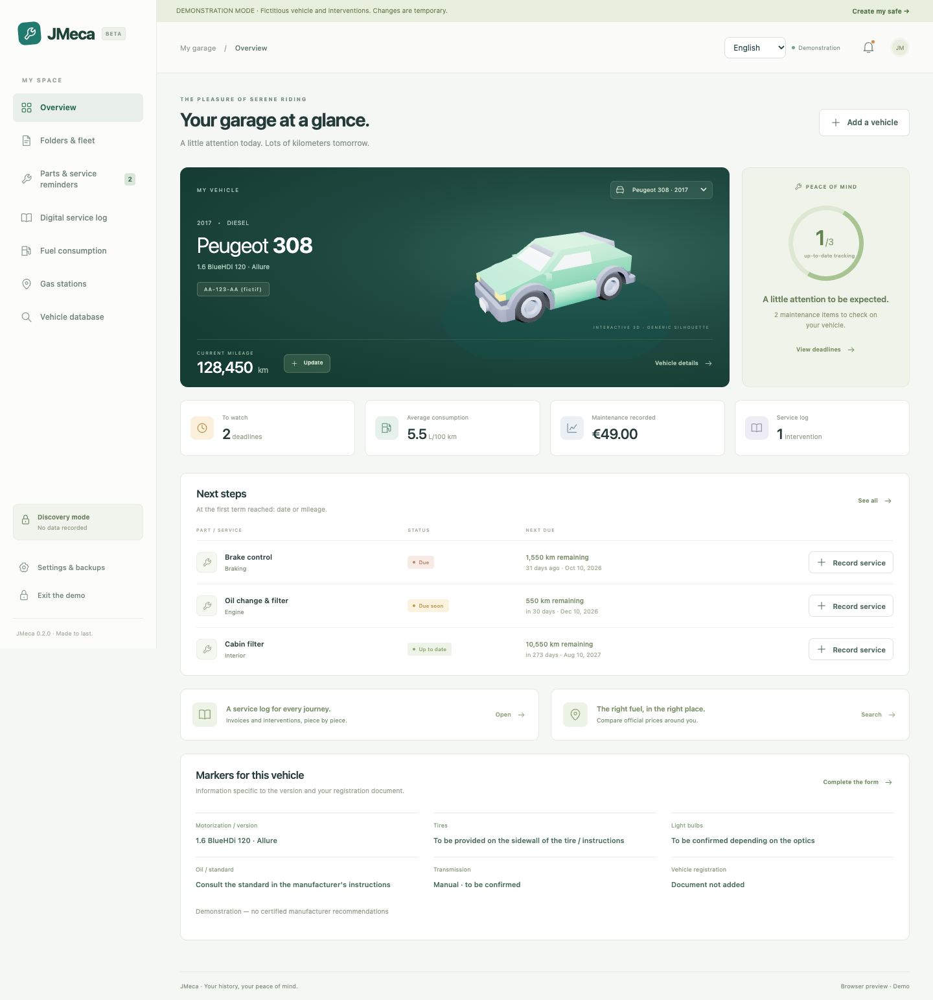
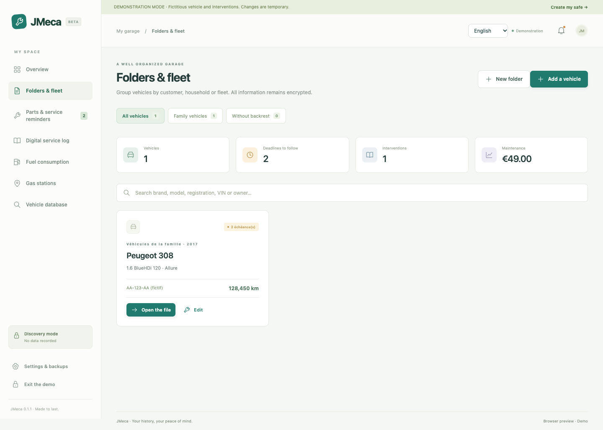
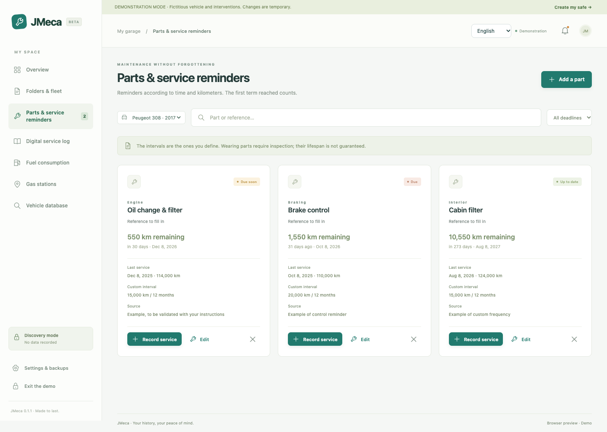
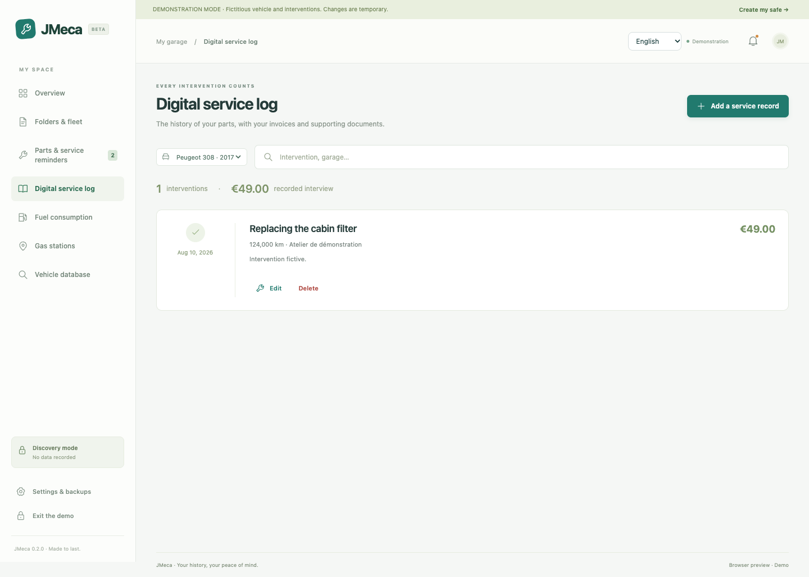
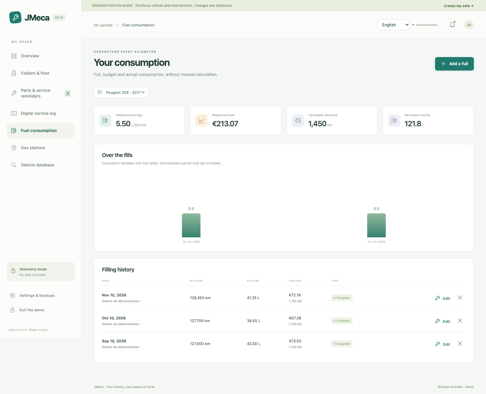
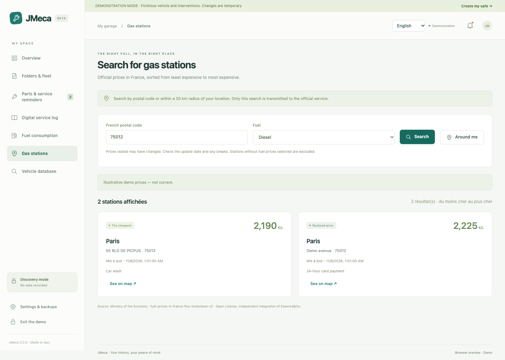
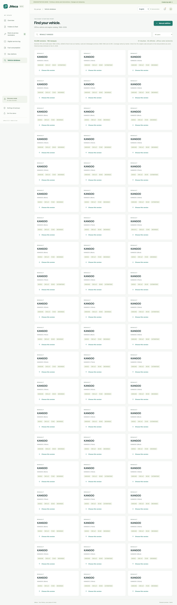

# JMeca

[Français](README.fr.md) · [Español](docs/README.es.md) · [Deutsch](docs/README.de.md) · [Italiano](docs/README.it.md) · [Português](docs/README.pt.md) · [简体中文](docs/README.zh-CN.md) · [日本語](docs/README.ja.md)

JMeca is a lightweight desktop garage and maintenance tracker for Windows, macOS and Linux. It uses Tauri 2, Rust and TypeScript, with the operating system's web engine. The interface is available in **French, English, Spanish, German, Italian, Portuguese, Simplified Chinese and Japanese**. It follows the system language on first launch and has a language selector.

👉 **[Download the Windows, macOS and Linux preview](https://github.com/jeremdevgit/jmeca/releases/tag/v0.1.1-beta.1)**. These are early builds; only macOS was launched locally. The macOS application is not Apple notarized.

## Features

- Multiple vehicles, client or household folders, fleet search and active vehicle switching.
- Parts, custom service intervals by date or mileage, upcoming and overdue reminders.
- Digital service log with invoices and photos, vehicle registration document and technical notes.
- Fuel consumption and expense tracking, and French fuel station prices from official open data.
- Offline ADEME catalog of 3,604 vehicle versions and engines, plus nine generic 3D vehicle silhouettes and optional GLB import.
- Password protected local vault, encrypted backups, restore and automatic lock after inactivity.

## Screenshots

Demo screenshots use fictional vehicles and illustrative fuel prices.

 

 

 

[All screenshots, including registration, attachments, 3D, settings and backups](captures/fr/)

## Quality checks

| Check | Result |
|---|---|
| TypeScript production build | Passed locally |
| Core unit tests | 11 passed |
| Browser flows, security regression and 8 languages | 16 passed |
| Rust unit tests | 2 passed |
| Rust formatting and Clippy warnings | Passed locally; enforced in CI |
| JavaScript and Rust vulnerability advisories | No known vulnerability reported at review time |

The [CI workflow](.github/workflows/build.yml) repeats dependency audits, tests and desktop builds on GitHub. Its live badge above reflects the remote run. Static analysis identified two application issues before publication; both were fixed and covered by regression tests. The Rust advisory scan also reports informational maintenance notices for transitive crates; see the build log.

## Try it

Run `npm ci` followed by `npm run desktop:dev` with the [Tauri prerequisites](https://tauri.app/start/prerequisites/) installed. Choose the demo for fictional data. To store real data, create a password of at least 12 characters and export an encrypted backup to another drive. A browser preview is available with `npm run dev`; its encrypted IndexedDB vault is separate from the desktop app.

Run `npm run build`, `npm test`, `npx playwright test` and `cargo test --locked --manifest-path src-tauri/Cargo.toml` for checks. `npm run desktop:build` builds an installer for the current platform. GitHub Actions can build all three platforms manually; downloaded artifacts must be tested on their target systems before use. The macOS development build is locally signed and is not Apple notarized.

## Security and limits

JMeca encrypts vault contents and attachments at rest with AES-256-GCM. The key is derived from your password with PBKDF2-SHA-256 (600,000 iterations). The password is not stored. Encryption cannot protect an unlocked vault on a compromised computer. An exported attachment leaves the encrypted vault. Previous backups can still contain deleted data or an old password.

Service intervals, compatible part references, tire dimensions and bulb types must be checked against the manual for the exact vehicle. The ADEME catalog is not a certified maintenance database. The station search uses French official open data, not an Essence&Co API. Reminders appear while JMeca is open; there are no background notifications or multi-user accounts. A full vault snapshot is rewritten on each save, so this version is suited to a personal garage or a small local workshop, not a large fleet.

See [the French documentation](README.fr.md) for detailed behavior and [third-party sources](THIRD_PARTY.md) for data and licenses. Original code is licensed under GPL-3.0-or-later; third-party materials retain their own licenses.

## My software

[Public profile: jeremdevgit](https://github.com/jeremdevgit) · [Carnet Rust](https://github.com/jeremdevgit/carnet-rust) · [Suite libre](https://github.com/jeremdevgit/suite-libre) · [Batailles de France](https://github.com/jeremdevgit/batailles-de-france) · [Pomme](https://github.com/jeremdevgit/pomme) · [Ludothèque](https://github.com/jeremdevgit/ludotheque) · [rJb](https://github.com/jeremdevgit/rjb) · [Boîte à outils](https://github.com/jeremdevgit/boite-a-outils).
