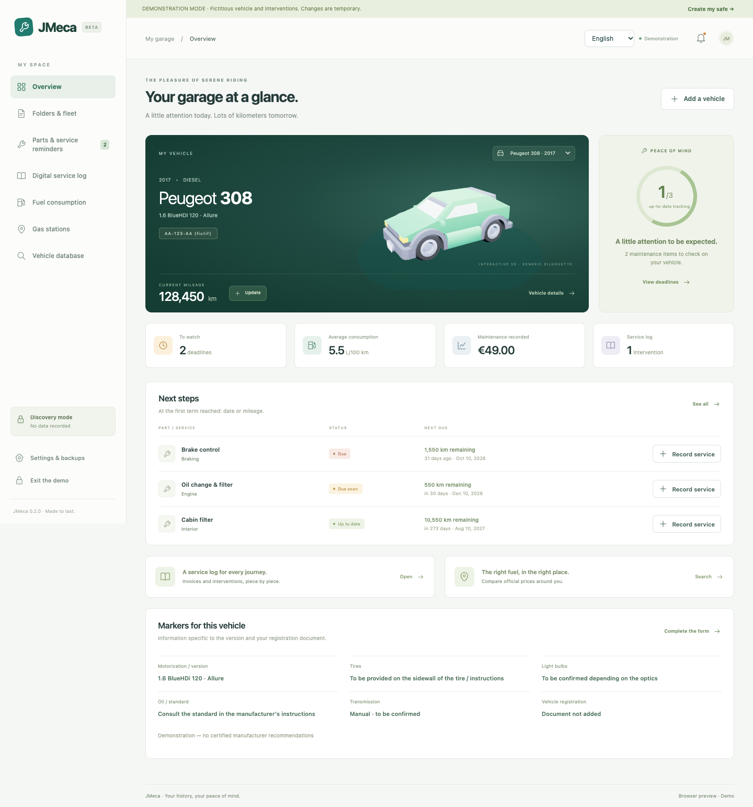

<p align="center"></p>

<h1 align="center">JMeca</h1>

<p align="center"><b>为所有车辆打造的加密车库：保养、提醒、维修记录、油耗与费用。</b></p>

<p align="center"> <a href="https://github.com/jeremdevgit/jmeca/releases"></a> <a href="LICENSE"></a> <a href="https://github.com/jeremdevgit/jmeca/actions/workflows/build.yml"></a></p>

<p align="center"><a href="README.md">English</a> · <a href="README.fr.md">Français</a> · <a href="README.es.md">Español</a> · <a href="README.de.md">Deutsch</a> · <a href="README.it.md">Italiano</a> · <a href="README.pt.md">Português</a> · <b>简体中文</b> · <a href="README.ja.md">日本語</a></p>

<p align="center"><a href="https://github.com/jeremdevgit/jmeca/releases"><b>⬇ 下载</b></a></p>



JMeca 是一款桌面车库与保养记录应用，基于 Tauri 2、Rust 和 TypeScript，使用系统自带的网页引擎。适合家庭或小型修车铺。

## 概览

| | |
|---|---|
| **类别** | 📒 效率与数据 |
| **平台** | Windows · macOS · Linux |
| **界面语言** | 8 种语言（英、法、西、德、意、葡、中、日） |
| **价格** | 免费、开源、无广告、无遥测 |
| **状态** | Beta |
| **许可证** | [GPL-3.0-or-later](LICENSE) |

## 功能

- **多辆车**、客户或家庭档案、车队搜索与快速切换。
- **保养**：零件、按日期或里程自定义保养周期、即将到期和已逾期提醒、车队保养队列、按客户导出 CSV 报告。
- **电子保养手册**：发票和照片、行驶证以及技术备注。
- **油耗与费用**：油耗、开支，以及来自法国官方开放数据的加油站油价。
- **离线车型库**：1980–2026 年共 53,596 个版本（EPA、ADEME 和厂商资料），九种通用 3D 车型轮廓、可定制的 Audi A3 8P 模型，并支持导入 GLB。

<p> </p>
<p> </p>

*演示截图使用虚构车辆和示例价格。[全部截图](captures/)。*

## 你的数据

- 保险库和附件使用 **AES-256-GCM** 加密；密钥由你的密码派生（PBKDF2-SHA-256，600,000 次迭代）。密码从不保存。
- 闲置自动锁定，**加密备份**与恢复。
- 导出的 CSV 和附件经确认后以明文离开保险库。旧备份可能仍包含已删除的数据或旧密码。
- 保养周期、零件编号、轮胎尺寸和灯泡型号请以车辆手册为准：车型库不是经过认证的数据库。

## 安装

| | Windows 10/11 | macOS 12+ | Linux |
|---|---|---|---|
| 文件 | `JMeca-Setup-Windows-x64.exe` | `.pkg`（推荐）或 `.dmg`，通用版 | `.deb`（Debian/Ubuntu x64） |
| 引擎 | WebView2 | WebKit | WebKitGTK 4.1 |

请在[版本页面](https://github.com/jeremdevgit/jmeca/releases)下载，并与 `SHA256SUMS.txt` 比对。安装程序没有商业证书签名，也未经公证：Windows 上在 SmartScreen 中确认，macOS 上使用*系统设置 › 隐私与安全性 › 仍要打开*。替换应用不会删除你的保险库。

## 从源码构建

```sh
npm ci
npm run desktop:dev        # 需要 Tauri 前置依赖；选择演示可使用虚构数据
npm run build && npm test && npx playwright test
cargo test --locked --manifest-path src-tauri/Cargo.toml
npm run desktop:build      # 为当前平台生成安装程序
```

`npm run dev` 会启动浏览器预览，使用独立的加密 IndexedDB 保险库。在 macOS 上，`zsh scripts/package_macos.sh` 会生成 `.dmg`、`.pkg` 和校验值。

**限制**：只有 JMeca 打开时才显示提醒；没有多用户账号；每次保存都会重写整个保险库。在 Linux 上，WebKitGTK 依赖链包含一个已知的 `glib` 安全通告，JMeca 不会调用相关接口，上游也尚未修复（[SECURITY.md](SECURITY.md)）。

## 许可证

GPL-3.0-or-later，见 [LICENSE](LICENSE)。数据来源和第三方许可证：[THIRD_PARTY.md](THIRD_PARTY.md)。

---

发现安全漏洞？请私下报告（见 [SECURITY.md](SECURITY.md)），不要发公开 issue。

## jeremdevgit 的其他自由软件

全部免费、开源、无广告。

**🛠️ 系统与硬件** — [Boîte à outils](https://github.com/jeremdevgit/boite-a-outils) · [rJb](https://github.com/jeremdevgit/rjb) · [LJ Hub](https://github.com/jeremdevgit/lj-hub) · [Decklight](https://github.com/jeremdevgit/decklight)

**📒 效率与数据** — [Carnet de notes](https://github.com/jeremdevgit/carnet-rust) · [Suite Libre](https://jeremdevgit.github.io/suite-libre/)

**🎮 音乐与游戏** — [Pomme](https://github.com/jeremdevgit/pomme) · [Ludothèque](https://github.com/jeremdevgit/ludotheque) · [AutoDex](https://github.com/jeremdevgit/autodex) · [Batailles de France](https://github.com/jeremdevgit/batailles-de-france)
